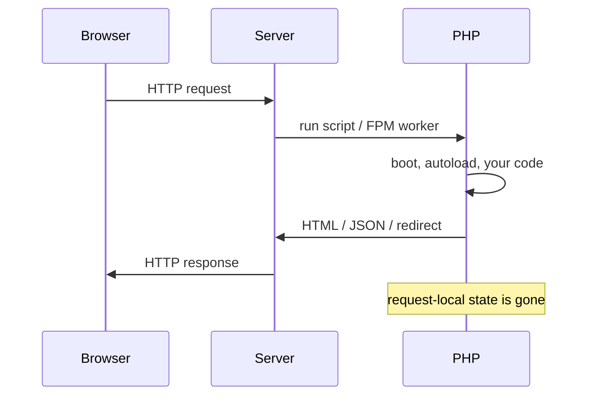

# Why PHP in 2026

> I've recently motivated myself to properly learn PHP again - not the 2012 "put HTML in a file" vibe, but the language Laravel and Symfony actually sit on.

## The honest pitch

PHP still runs a ridiculous chunk of the web. WordPress alone is half the internet-ish, and then there's Laravel shops, Symfony shops, Magento, custom APIs… If you care about full-stack or backend jobs in 2026, PHP is still a very real skill.

But more importantly for us: modern PHP is… fine. Actually good. Typed, namespaced, with Composer, enums, attributes, match expressions. It doesn't feel like a relic once you stop comparing it to the PHP 5 trauma stories.

## Mental model vs Node / SPA

Here's the thing that trips front-end folks the hardest.

In a typical Node Express (or Next API route) world, you often think of a **long-lived process**. The app boots once, stays in memory, handles many requests.

Classic PHP (and what most shared hosting / FPM setups still do):

1. Request comes in
2. PHP boots your script (or FPM worker picks it up)
3. Your code runs
4. Response goes out
5. Process is done (worker may recycle, but **your** request-local state is gone)

There's no "component state" sitting between clicks. Variables die with the request. Need something to survive? Session, cookie, database, cache, file - pick one.

I've always liked that mental model. One request, one job. Frameworks add structure on top, but the boundary is still there.

## Where PHP sits in 2026

| Thing | Rough vibe |
| --- | --- |
| Language | PHP 8.3 / 8.4+ - typed, modern OOP |
| Packages | Composer (npm-ish, but for PHP) |
| Web frameworks | Laravel, Symfony (we'll prep for them, not teach them yet) |
| Runtime | php-fpm + nginx/apache, or `php -S` locally, or FrankenPHP / RoadRunner in cooler setups |
| Types | Optional but you **should** use `strict_types` |

You don't need to love PHP. You need to understand it well enough that opening a Laravel controller doesn't feel like witchcraft.

## What "good enough" looks like after this tutorial

- Read and write typed PHP without googling every keyword
- Use Composer and PSR-4 autoloading
- Handle a form, a session, a DB query safely
- Sketch a tiny router so "routing" isn't magic
- Know the vocabulary Laravel/Symfony tutorials assume

And you know what? That's enough. The frameworks will teach framework things. We're building the floor.

Best,

-- ł.
