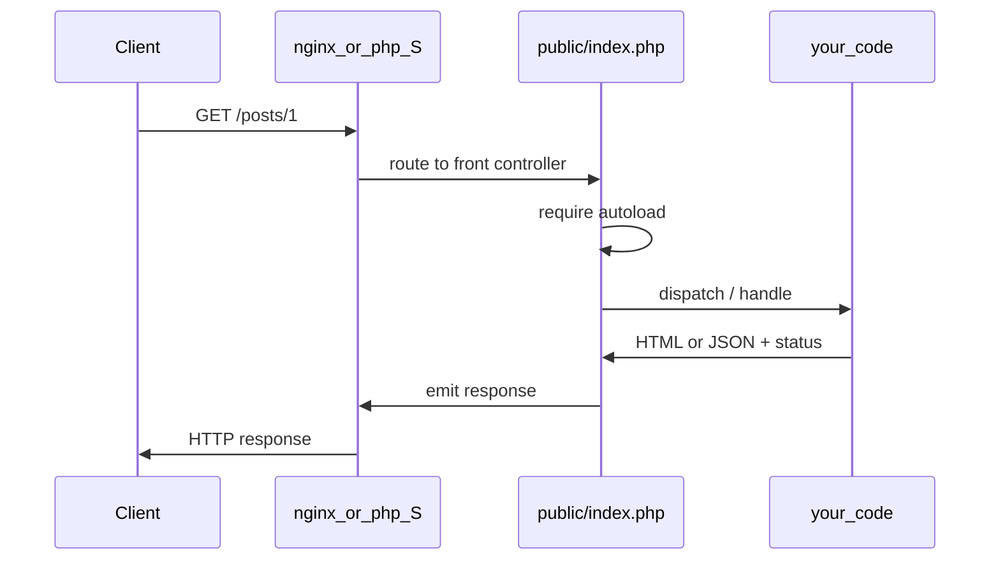

# HTTP lifecycle

> Request comes in, PHP runs, response goes out. Frameworks decorate this. They don't replace it.

## The loop



In learning mode with the built-in server, `public/index.php` **is** the front controller.

## Reading the request (raw PHP)

```php
<?php

declare(strict_types=1);

$method = $_SERVER['REQUEST_METHOD'] ?? 'GET';
$uri    = $_SERVER['REQUEST_URI'] ?? '/';
$path   = parse_url($uri, PHP_URL_PATH);

$query = $_GET;  // already parsed query string
$body  = file_get_contents('php://input'); // raw body (JSON APIs)
```

Comments for the code above:

- `$_SERVER`, `$_GET`, `$_POST` are **superglobals** - available everywhere (and a bit spooky; frameworks wrap them)
- For JSON APIs, don't use `$_POST` - parse `php://input`
- Path vs full URI matters for routing

## Writing the response

```php
<?php

declare(strict_types=1);

http_response_code(201);
header('Content-Type: application/json; charset=utf-8');
header('X-Powered-By: curiosity');

echo json_encode(['ok' => true], JSON_THROW_ON_ERROR);
```

Headers must be sent **before** body output. Accidental whitespace before `<?php` will ruin your day ("headers already sent").

## Redirects

```php
<?php

declare(strict_types=1);

http_response_code(302);
header('Location: /login');
exit;
```

Always `exit` (or `return` from front controller) after a redirect so you don't keep rendering.

## Content negotiation (simple)

```php
<?php

declare(strict_types=1);

$accept = $_SERVER['HTTP_ACCEPT'] ?? 'text/html';

if (str_contains($accept, 'application/json')) {
    header('Content-Type: application/json');
    echo json_encode(['message' => 'hi'], JSON_THROW_ON_ERROR);
} else {
    header('Content-Type: text/html; charset=utf-8');
    echo '<p>hi</p>';
}
```

Frameworks do this better. Knowing the headers helps when debugging.

## Front controller pattern

One entry file:

```php
<?php

declare(strict_types=1);

require __DIR__ . '/../vendor/autoload.php';

// route + dispatch...
```

Web server rewrites all requests to `index.php` (Apache `RewriteRule`, nginx `try_files`, or php built-in router script). That's how Laravel/Symfony feel like "pretty URLs".

We'll build a tiny version in [Mini router](/guide/19-mini-router).

## Compared to Next / Nuxt

| Front-end SSR / API routes | Classic PHP |
| --- | --- |
| Long-lived or edge runtime | Per-request script / FPM worker |
| `Request` / `Response` objects | Superglobals + `header()` / `echo` (or PSR-7 libs) |
| File-based routing | Explicit router or framework router |
| Middleware chain | Middleware chain (framework) or manual |

Same HTTP. Different packaging.

Best,

-- ł.
