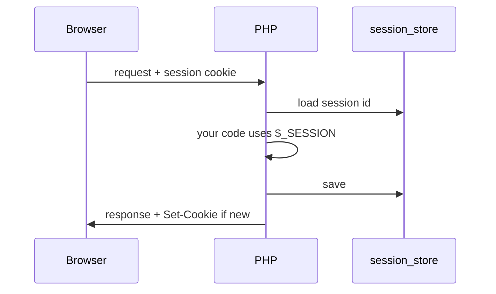

# Sessions & cookies

> HTTP is stateless. Cookies + sessions are how "logged in" survives between requests - without a SPA store.

## Cookies (client-side stash the server can read)

```php
<?php

declare(strict_types=1);

setcookie('theme', 'dark', [
    'expires' => time() + 60 * 60 * 24 * 30,
    'path' => '/',
    'secure' => true,      // HTTPS only
    'httponly' => true,    // no document.cookie
    'samesite' => 'Lax',
]);

$theme = $_COOKIE['theme'] ?? 'light';
```

Never store passwords or roles in a plain cookie you trust blindly. Prefer a session id cookie + server-side session data.

## Sessions (server-side bag)

```php
<?php

declare(strict_types=1);

session_start();

$_SESSION['user_id'] = 42;
$_SESSION['cart'] = $_SESSION['cart'] ?? [];

$userId = $_SESSION['user_id'] ?? null;
```

Flow:

1. `session_start()` - reads session cookie, loads data (files by default)
2. You read/write `$_SESSION`
3. PHP saves it at shutdown



## Login sketch

```php
<?php

declare(strict_types=1);

session_start();

// after verifying password...
session_regenerate_id(true); // prevent fixation
$_SESSION['user_id'] = $user->id;

// logout
$_SESSION = [];
session_destroy();
```

`session_regenerate_id(true)` on login is not optional in real apps.

## CSRF seed (why sessions matter for forms)

Cross-site request forgery: evil site POSTs to your site; browser sends your cookies.

Mitigation sketch:

```php
<?php

declare(strict_types=1);

session_start();

if (empty($_SESSION['csrf'])) {
    $_SESSION['csrf'] = bin2hex(random_bytes(32));
}

// in the form:
// <input type="hidden" name="_token" value="<?= htmlspecialchars($_SESSION['csrf']) ?>">

if (!hash_equals($_SESSION['csrf'], $_POST['_token'] ?? '')) {
    http_response_code(419);
    exit('Invalid CSRF token');
}
```

`hash_equals` avoids timing leaks. Frameworks bake this in (Laravel `_token`, Symfony forms). You should understand the dance.

## Session config worth knowing

- `session.cookie_secure`
- `session.cookie_httponly`
- `session.cookie_samesite`
- Save handlers: files (default), Redis, DB - frameworks configure these

## Compared to localStorage / JWT-in-localStorage

Server sessions + httpOnly cookies are still the boring default for traditional web apps. SPAs sometimes use JWT in memory / httpOnly cookies - different tradeoffs. Learning PHP web = learn sessions first.

Best,

-- ł.
