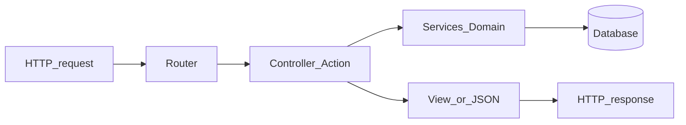

# Before Laravel / Symfony

> No framework tutorials here - just the vocabulary and mental models so the first official docs page doesn't feel like a wall of nouns.

## Shared shape: MVC-ish



- **Router** - path/method → callable (you built a mini one)
- **Controller** - thin HTTP adapter: validate input, call services, return response
- **Model / Entity** - data + sometimes behavior (Eloquent model vs Doctrine entity - different philosophies)
- **View** - Blade / Twig / JSON

You don't need to be dogmatic about MVC. Recognize the layers.

## Dependency injection container

Instead of:

```php
<?php

$controller = new UserController(new UserService(new PdoUserRepository(new PDO(...))));
```

The framework builds the graph:

```php
<?php

// conceptual
$controller = $container->get(UserController::class);
```

You type-hint dependencies in the constructor; the container auto-wires them. That's why Laravel/Symfony constructors look so clean.

**Prep tip:** practice writing classes that receive collaborators via constructor - not via `new` inside methods. You've already seen this style in modern Nest/Angular; same idea.

## Middleware / event pipeline

```text
request → middleware1 → middleware2 → controller → response → middleware2 → middleware1
```

Auth, sessions, CORS, localization - all middleware (Laravel) or event subscribers / request listeners (Symfony feels similar in practice).

Our router stretch goal of wrapping a handler is the toy version.

## Config & env

| Concern | Typical home |
| --- | --- |
| Secrets | `.env` (not committed) |
| App config | `config/*.php` |
| Environment | `local` / `production` |

`env('DB_HOST')` / `%env(DB_HOST)%` - read at boot, inject config objects. Don't scatter `getenv` calls in random classes.

## Migrations (as an idea)

Instead of hand-running SQL on each machine:

1. Write a migration class: `up()` / `down()`
2. Run CLI: migrate
3. Team shares schema via git

Laravel migrations and Doctrine Migrations are twins. PDO still runs underneath.

## Console twins

| Laravel | Symfony | Purpose |
| --- | --- | --- |
| `artisan` | `bin/console` | CLI entry |
| `artisan make:controller` | `bin/console make:controller` | codegen |
| `artisan migrate` | `bin/console doctrine:migrations:migrate` | schema |

You'll live in these CLIs. They're just PHP scripts with a command router.

## Eloquent vs Doctrine (one paragraph)

- **Eloquent** (Laravel) - active record: `$user->save()`
- **Doctrine** (common in Symfony) - data mapper: `$em->persist($user); $em->flush()`

Both solve persistence. Different mental models. Neither removes SQL from your life forever.

## What the framework owns vs what you still write

**Framework owns:** routing, DI, session glue, validation helpers, ORM integration, mail abstractions, queue workers, auth scaffolding…

**You still write:** domain rules, queries that matter, authorization policy, UI/API shape, tests for your behavior, performance judgment.

That's why learning raw PHP first was worth it - when the abstraction leaks (and it will), you can peek underneath without panic.

## Suggested order after this tutorial

1. Rebuild something small in **Laravel** *or* **Symfony** (pick based on job market / taste - Laravel is often faster to first joy; Symfony is explicit and great for larger systems)
2. Build: auth + CRUD + one API endpoint + tests
3. Read the framework's request lifecycle docs with your mini-router in mind
4. Come back to Composer, PSR, and security chapters when something feels fuzzy

You're ready enough. The rest is reps.

Wish you all the best - go build something.

Best,

-- ł.
